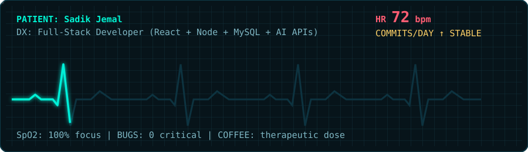
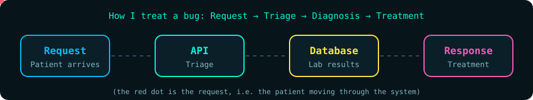

<div align="center">


</div>

<br/>



## `$ whoami`

```js
const sadik = {
  name: "Sadik Jemal",
  role: "Full-Stack Web Developer",
  alsoStudying: "Medicine @ Arsi University (5th year)",
  trainedAt: "Evangadi",
  focus: ["React", "Node.js / Express", "MySQL", "AI API integration"],
  currentGoal: "Ship real products that solve real problems",
};
```

## 🧬 Tech Stack

<div align="center">

<br/>
<br/>


</div>


## 🩺 Featured Projects (Case Files)

| Case | Diagnosis (what it does) | Treatment (stack) |
|---|---|---|
| [**AI-Powered Evangadi Forum**](https://github.com/abuseaad/REPO-NAME) | Q&A forum with Gemini-based semantic search and RAG | Node, Express, MySQL, Gemini API |
| [**GPT Clone**](https://github.com/abuseaad/REPO-NAME) | ChatGPT-style chat app with authentication | React, Express, MySQL, Gemini |
| [**Portfolio**](https://github.com/abuseaad/REPO-NAME) | Personal portfolio rebuilt from a template to React | React, Vite |
| [**devTeam Forum**](https://github.com/walidabdulkadir/forum) | Team forum backend with auth module | Node, Express, MySQL |



## 📊 Vital Signs (GitHub Stats)

<div align="center">


<br/><br/>


</div>

## 📬 Contact

<div align="center">

[](mailto:sadikarsi19@gmail.com)
[](https://www.linkedin.com/in/sadik-jemal-aa82773b5)
[](https://t.me/sjarsi19)

<br/>

*"First, do no harm. Then, push to main."* 🩺💻


</div>